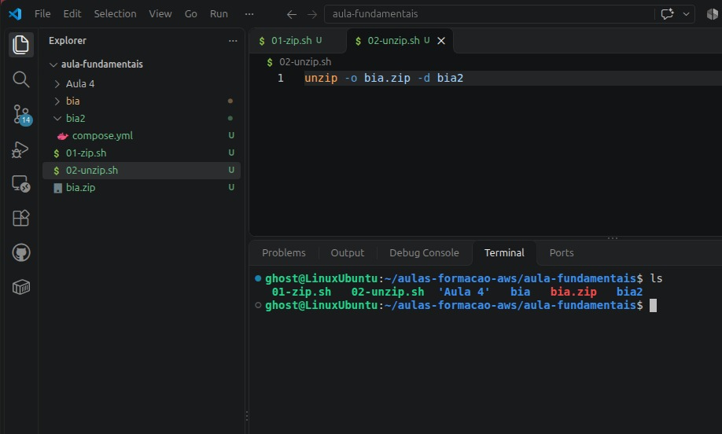
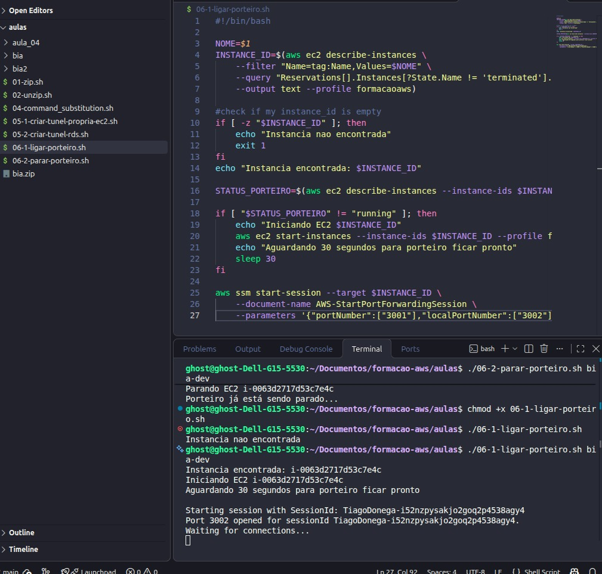
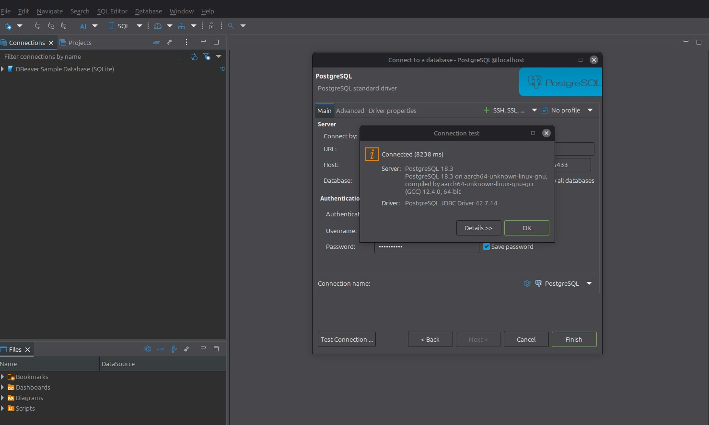
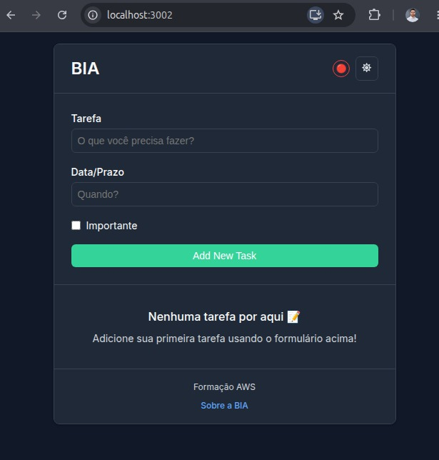

# ☁️ AWS EC2, SSM Tunnels & Private RDS Automation Lab

**Automated Bastion Lifecycle, Zero-Trust Port Forwarding & Private PostgreSQL Access on Linux**

---

## 🖥️ Architecture & Animated Workflow

https://github.com/user-attachments/assets/0223a20e-6928-4f7e-a533-3d356cdf7605

Practical cloud infrastructure and automation lab built on a Linux environment, implementing **Zero-Trust** access and **FinOps** cost control on AWS. Modular Bash scripts (`01-zip.sh`, `02-unzip.sh`, `05-1-criar-tunel-propria-ec2.sh`, `05-2-criar-tunel-rds.sh`, `06-1-ligar-porteiro.sh`, and `06-2-parar-porteiro.sh`) orchestrate the on-demand lifecycle of an EC2 Bastion host and establish encrypted **AWS Systems Manager (SSM)** port-forwarding tunnels — completely eliminating SSH keys and public database exposure.

---

## 📄 Complete Technical Documentation

For the full step-by-step technical guide, objectives, architecture breakdown, and validation walkthrough, access the complete PDF document:

📘 **[Download / View Complete Technical Material (PDF)](./docs/ws-ec2-ssm-rds-bash-automation.pdf)**

---

## 🛠️ Technologies & Tools

* **Cloud Infrastructure:** Amazon EC2 (Bastion Host & Docker Server), Amazon RDS (Private PostgreSQL 18.3), AWS Systems Manager (SSM Port Forwarding), Amazon VPC & Security Groups (`bia-db`), AWS IAM
* **Operating System & Automation:** Linux, Bash / Shell Scripting, AWS CLI v2, AWS Session Manager Plugin
* **Containers & Database Administration:** Docker, Docker Compose, DBeaver (PostgreSQL JDBC)
* **Version Control & IDE:** Git, GitHub, Visual Studio Code

---

## 🧪 Execution & Validation Evidence

| Packaging Automation (Bash) | EC2 Bastion Lifecycle & SSM Tunnel |
| :---: | :---: |
|  |  |
| *Shell scripts (`01-zip.sh` & `02-unzip.sh`) packaging the BIA app into `bia.zip` and extracting a clean copy into `bia2`.* | *Bash + AWS CLI scripts stopping and starting the `bia-dev` EC2 on demand (FinOps) and opening the SSM tunnel on port `3002`.* |

| Private Amazon RDS via DBeaver (Port 5433) | BIA Web App via Local Tunnel (Port 3002) |
| :---: | :---: |
|  |  |
| *Successful DBeaver connection to the private Amazon RDS PostgreSQL 18.3 database at `localhost:5433` via SSM bridge.* | *BIA web application running locally at `localhost:3002` through the SSM tunnel (`3002 → 3001`) without public EC2 exposure.* |
